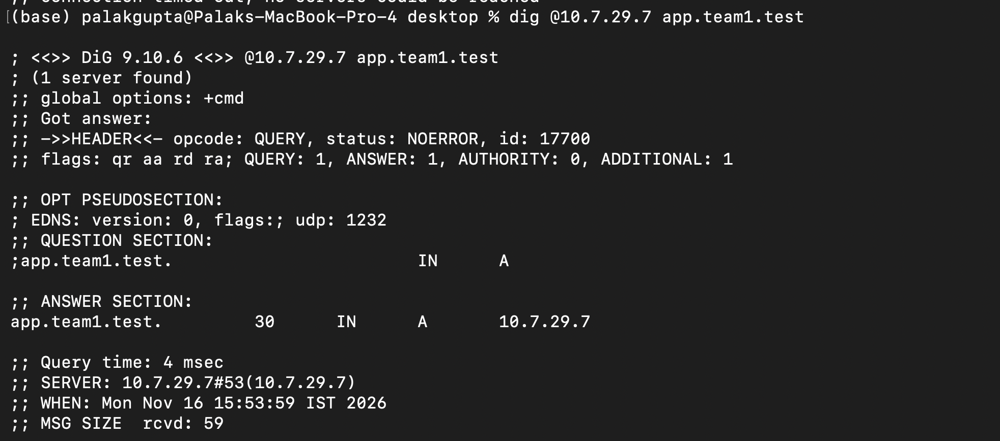
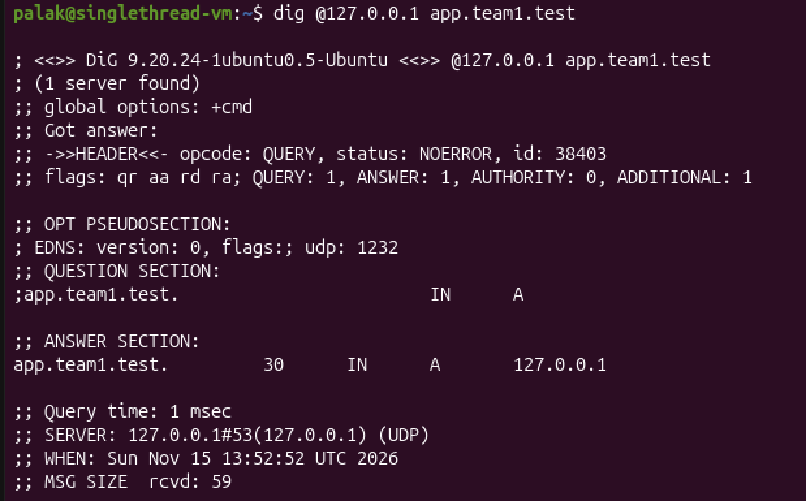
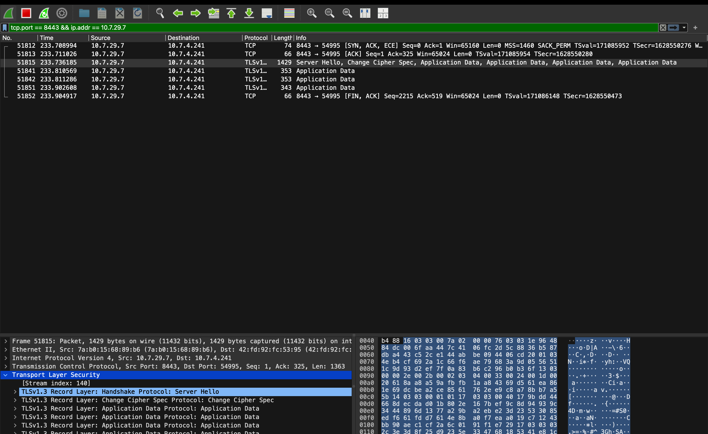
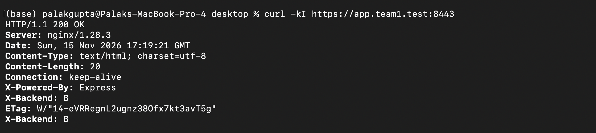
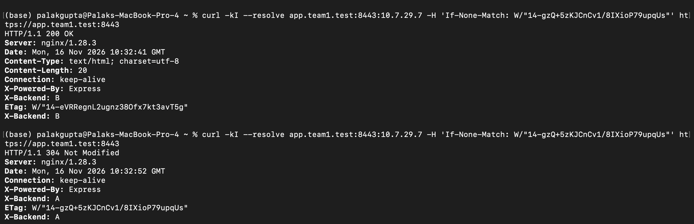
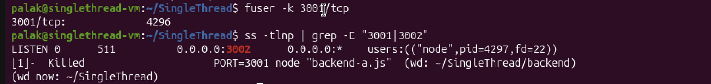
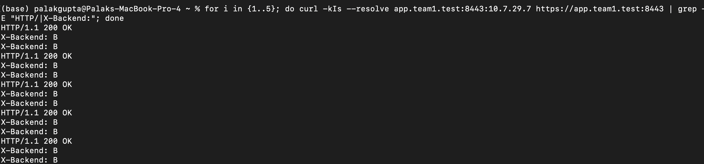
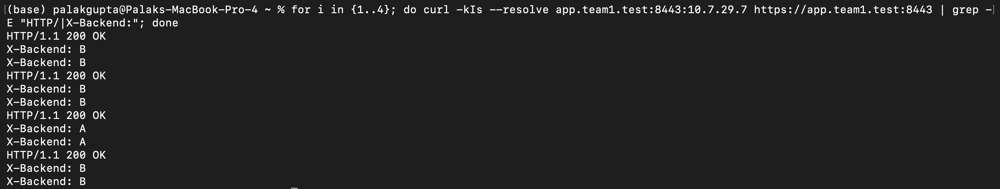

# SingleThread: Multi-Tier Private Network Simulation & Service Platform

A resilient, multi-tier private network architecture simulating an enterprise web application delivery platform across macOS and Ubuntu environments. This project demonstrates DNS resolution, edge reverse proxying, TLS termination, round-robin load balancing, HTTP caching, network hardening via firewall service isolation, high-availability failover/recovery, and Wireshark protocol-level packet analysis.

---

## 📋 Project Information

* **Course:** Computer Networks
* **Project:** Phase 1 (Build & Observe) & Phase 2 (Harden & Recover)
* **Team Name:** SingleThread
* **Student Name:** Palak Gupta
* **Enrollment Number:** 2401010312

---

## 🏗️ Architecture & Network Topology

The architecture separates responsibilities across client, edge proxy, and redundant backend application tiers:

```
+-----------------------------------------------------------------------------------+
|                                macOS Client (Host)                                |
|  - Web Browser / curl                                                             |
|  - Local DNS resolution / client requests                                         |
+-----------------------------------------------------------------------------------+
                                         │
                 DNS Query (UDP/53)      │ HTTPS Requests (TCP/8443 with TLSv1.3)
                 `app.team1.test`        │ Handshake & Encrypted Payloads
                                         ▼
+-----------------------------------------------------------------------------------+
|                         Ubuntu VM (10.7.29.7) - Edge Tier                         |
|                                                                                   |
|  [ UFW Firewall ] ──► Inbound 8443/tcp ALLOWED; direct 3001/3002 DROPPED/TIMEOUT  |
|                                         │                                         |
|  [ dnsmasq DNS Resolver ] (Port 53)     │                                         |
|    Resolves `app.team1.test` ──► 10.7.29.7 (TTL: 30s)                             |
|                                         │                                         |
|  [ Nginx Edge Reverse Proxy & Load Balancer ] (Port 8443 SSL)                     |
|    - TLS Termination (X.509 Certificates)                                         |
|    - Upstream Round-Robin Load Balancer (`backend_pool`)                          |
|    - Automatic failover & dynamic recovery                                        |
|    - Appends `X-Backend` header tracking                                          |
+-----------------------------------------------------------------------------------+
                                   │              │
                   HTTP/1.1 (3001) │              │ HTTP/1.1 (3002)
                   Internal Pass   │              │ Internal Pass
                                   ▼              ▼
           +──────────────────────────────+  +──────────────────────────────+
           |       Backend Server A       |  |       Backend Server B       |
           |      Node.js / Express       |  |      Node.js / Express       |
           |      Port: 3001 (Internal)   |  |      Port: 3002 (Internal)   |
           |      Header: `X-Backend: A`  |  |      Header: `X-Backend: B`  |
           |      ETag + Cache-Control    |  |      ETag + Cache-Control    |
           +──────────────────────────────+  +──────────────────────────────+
```

### Machine Roles & Network Service Mapping

| Node | Primary Role | Running Services & Ports | Production Equivalent |
| :--- | :--- | :--- | :--- |
| **macOS (Host)** | Client & Test Node | `curl`, Web Browser, `dig`, `/etc/hosts` | External End-User & Managed DNS |
| **Ubuntu VM** (`10.7.29.7`) | Edge Proxy & Load Balancer | Nginx (`8443` SSL, `80` HTTP), `ufw` firewall | Cloud Load Balancer / Application Gateway |
| **Ubuntu VM** (`10.7.29.7`) | Private DNS Resolver | `dnsmasq` (`53` UDP/TCP, TTL: 30s) | Authoritative / Local DNS Server |
| **Ubuntu VM** (Localhost) | Backend Application A | Node.js Express (`3001` TCP) | Application Server Instance A |
| **Ubuntu VM** (Localhost) | Backend Application B | Node.js Express (`3002` TCP) | Application Server Instance B |

### Protocol Request-Flow Sequence

1. **Application Layer (DNS Resolution):** Client queries local DNS resolver for `app.team1.test`. `dnsmasq` answers with `10.7.29.7` with a low TTL (30 seconds) for agile routing cutovers.
2. **Network/Transport Layer (TCP Handshake):** Client initiates a 3-way TCP handshake (`SYN` → `SYN-ACK` → `ACK`) with the edge proxy on destination port `8443`.
3. **Session & Security Layer (TLS Negotiation):** Client and Nginx complete a TLSv1.3 handshake (`ClientHello` → `ServerHello`, certificate exchange, cipher negotiation, master secret derivation) to encrypt transport payloads.
4. **Edge Security & Routing (Firewall & Proxy):** UFW strictly isolates backend ports `3001` and `3002` from direct external access. Nginx terminates TLS, inspects the request, attaches `X-Real-IP`, and forwards it to the upstream round-robin pool.
5. **Application Processing & Caching:** The selected Node.js backend processes the request, returning data with `ETag` and `Cache-Control` headers. If the client supplies `If-None-Match`, a lightweight `304 Not Modified` is returned.
6. **Response Delivery:** Nginx injects the `X-Backend` header indicating which upstream handled the request and transmits the TLS-encrypted payload back to the client.

---

## 📁 Repository Structure

```
.
├── README.md                           # Main documentation & verification report
├── package.json                        # Node.js dependencies
├── backend/
│   ├── backend-a.js                    # Node.js backend service A (Port 3001)
│   └── backend-b.js                    # Node.js backend service B (Port 3002)
├── config-bundle/
│   ├── SETUP_AND_RUN.md                # Deployment and step-by-step setup guide
│   ├── dnsmasq.conf                    # DNS resolver configuration with 30s TTL
│   ├── nginx-Phase_1.conf              # Phase 1 basic HTTP reverse proxy configuration
│   └── nginx-Phase_2.conf              # Phase 2 hardened SSL & load balanced configuration
└── docs/
    ├── Complete Architecture Document.pdf  # Comprehensive architecture specification
    ├── Phase_2_Final_Report.pdf            # Phase 2 report on hardening and recovery
    └── evidence/                           # Experimental verification evidence captures
        ├── dns-resolution-evidence.png
        ├── dns-ttl-resolver.png
        ├── wireshark-tls-8443.png
        ├── proxy-load-balancing-test.png
        ├── http-caching-304.png
        ├── service-isolation-firewall-block.png
        ├── ha-backend-a-down.png
        ├── ha-failover-test.png
        └── ha-recovery-test.png
```

---

## 🚀 Setup & Execution Guide

### 1. Launch Redundant Node.js Backends
From the project root on the VM / server:
```bash
# Start Backend A on Port 3001
PORT=3001 node backend/backend-a.js &

# Start Backend B on Port 3002
PORT=3002 node backend/backend-b.js &

# Verify both instances are active and listening
sudo ss -tlnp | grep -E "3001|3002"
```

### 2. Configure & Start DNS Service (`dnsmasq`)
Install and deploy [dnsmasq.conf](config-bundle/dnsmasq.conf):
```bash
sudo cp config-bundle/dnsmasq.conf /etc/dnsmasq.conf
sudo systemctl restart dnsmasq
sudo systemctl status dnsmasq
```

### 3. Deploy Nginx Reverse Proxy with TLS & Upstream Pool
Deploy the Phase 2 hardened configuration [nginx-Phase_2.conf](config-bundle/nginx-Phase_2.conf):
```bash
sudo cp config-bundle/nginx-Phase_2.conf /etc/nginx/nginx.conf
sudo nginx -t
sudo systemctl reload nginx
```

### 4. Implement UFW Firewall Rules (Service Isolation)
Enforce isolation so external callers cannot bypass Nginx to directly access backend ports:
```bash
# Allow only the TLS edge port
sudo ufw default deny incoming
sudo ufw default allow outgoing
sudo ufw allow 8443/tcp
sudo ufw enable
sudo ufw status verbose
```

---

## 📸 Experimental Verification & Evidence

This section contains all empirical markdown evidence captures validating DNS resolution, packet flows, reverse proxy load balancing, HTTP caching, firewall security, and high-availability failover.

---

### Evidence 1: Private DNS Resolution via `dnsmasq`
* **Objective:** Verify authoritative local DNS resolution for the custom `.test` domain.
* **Command:**
  ```bash
  dig @10.7.29.7 app.team1.test
  ```
* **Observation:** The DNS server `10.7.29.7#53` successfully responds with `NOERROR`, returning an `A` record pointing `app.team1.test` to `10.7.29.7` with a 30-second TTL in 4 ms.



---

### Evidence 2: Low DNS TTL Configuration for Agile Cutover
* **Objective:** Confirm that the DNS resolver advertises a short TTL (30 seconds) to facilitate rapid DNS migration and traffic redirection (Extension B).
* **Command:**
  ```bash
  dig @127.0.0.1 app.team1.test
  ```
* **Observation:** The answer section validates `app.team1.test. 30 IN A 127.0.0.1`, confirming that client caches will hold the mapping for no more than 30 seconds before re-querying the authority.



---

### Evidence 3: Wireshark Packet Inspection (TCP Handshake & TLSv1.3 Negotiation)
* **Objective:** Analyze network traffic at the packet level to confirm proper TCP connection setup and cryptographic security on port 8443.
* **Capture Filter:** `tcp.port == 8443 && ip.addr == 10.7.29.7`
* **Observation:** 
  1. Complete TCP 3-way handshake (`SYN`, `SYN-ACK`, `ACK`).
  2. TLSv1.3 Handshake Protocol negotiation including `Server Hello`, `Change Cipher Spec`, and encrypted `Application Data` exchanges.
  3. The Wireshark packet details pane confirms the full dissection of the `Transport Layer Security` record layer.



---

### Evidence 4: Edge Proxy Load Balancing & Header Routing
* **Objective:** Validate TLS termination on port 8443 and verify that Nginx proxies traffic to the backend instances while preserving tracking headers.
* **Command:**
  ```bash
  curl -kI https://app.team1.test:8443
  ```
* **Observation:** Nginx returns `HTTP/1.1 200 OK` under `Server: nginx/1.28.3` with custom tracking header `X-Backend: B` and `X-Powered-By: Express`.



---

### Evidence 5: HTTP Caching & Conditional Revalidation (`304 Not Modified`)
* **Objective:** Confirm efficient client-side caching using entity tags (`ETag`) and conditional `If-None-Match` requests.
* **Command:**
  ```bash
  curl -kI --resolve app.team1.test:8443:10.7.29.7 -H 'If-None-Match: W/"14-gzQ+5zKJCnCv1/8IXioP79upqUs"' https://app.team1.test:8443
  ```
* **Observation:** Initial request yields `200 OK` with generated `ETag`. The subsequent conditional request with matching ETag returns `HTTP/1.1 304 Not Modified` from `X-Backend: A`, avoiding redundant data transmission.



---

### Evidence 6: Service Isolation & Firewall Policy Enforcement (Extension C)
* **Objective:** Demonstrate that backend application ports (3001/3002) cannot be contacted directly by external clients, enforcing security boundaries through UFW.
* **Command:**
  ```bash
  curl --connect-timeout 5 http://10.7.29.7:3001
  ```
* **Observation:** The client request times out with `curl: (28) Failed to connect to 10.7.29.7 port 3001 after 5006 ms: Timeout was reached`. External access to backend services is strictly blocked while proxy traffic on `8443` remains accessible.


---

### Evidence 7: Fault Simulation — Backend A Outage
* **Objective:** Simulate an ungraceful crash or failure of Backend A on port 3001 to test upstream pool resilience.
* **Command:**
  ```bash
  fuser -k 3001/tcp
  ss -tlnp | grep -E "3001|3002"
  ```
* **Observation:** Process 4296 is killed; socket inspection confirms only port `3002` (Backend B) remains in `LISTEN` state.



---

### Evidence 8: High Availability (HA) Zero-Downtime Failover (Extension D)
* **Objective:** Verify that Nginx automatically detects the down node and routes 100% of client traffic to the healthy standby backend without dropping connections.
* **Command:**
  ```bash
  for i in {1..5}; do curl -kIs --resolve app.team1.test:8443:10.7.29.7 https://app.team1.test:8443 | grep -E "HTTP/|X-Backend:"; done
  ```
* **Observation:** All five successive requests succeed seamlessly with `HTTP/1.1 200 OK`, all handled by `X-Backend: B`. No `502 Bad Gateway` errors occur.



---

### Evidence 9: High Availability (HA) Dynamic Recovery & Re-Incorporation
* **Objective:** Validate that upon restarting Backend A, Nginx automatically detects the restored backend and re-incorporates it into active round-robin distribution.
* **Command:**
  ```bash
  for i in {1..4}; do curl -kIs --resolve app.team1.test:8443:10.7.29.7 https://app.team1.test:8443 | grep -E "HTTP/|X-Backend:"; done
  ```
* **Observation:** Responses immediately begin alternating between `X-Backend: A` and `X-Backend: B`, confirming full automated recovery without requiring proxy restarts.



---

## 📚 Technical Documentation & Reports

For in-depth architectural analysis and post-mortem findings, consult the project documents:
* [Complete Architecture Document (Phase 1 & Phase 2)](docs/Complete%20Architecture%20Document.pdf): Full specification of nodes, IP maps, layer-by-layer protocol interactions, and production equivalencies.
* [Phase 2 Final Report](docs/Phase_2_Final_Report.pdf): Deep dive into hardening changes, failure domain analysis, and Extension implementations A through F.
* [Setup & Run Guide](config-bundle/SETUP_AND_RUN.md): Step-by-step administrator guide for configuring TLS, launching background processes, and applying firewall policies.
